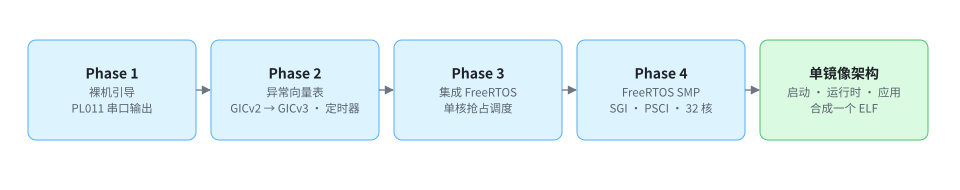
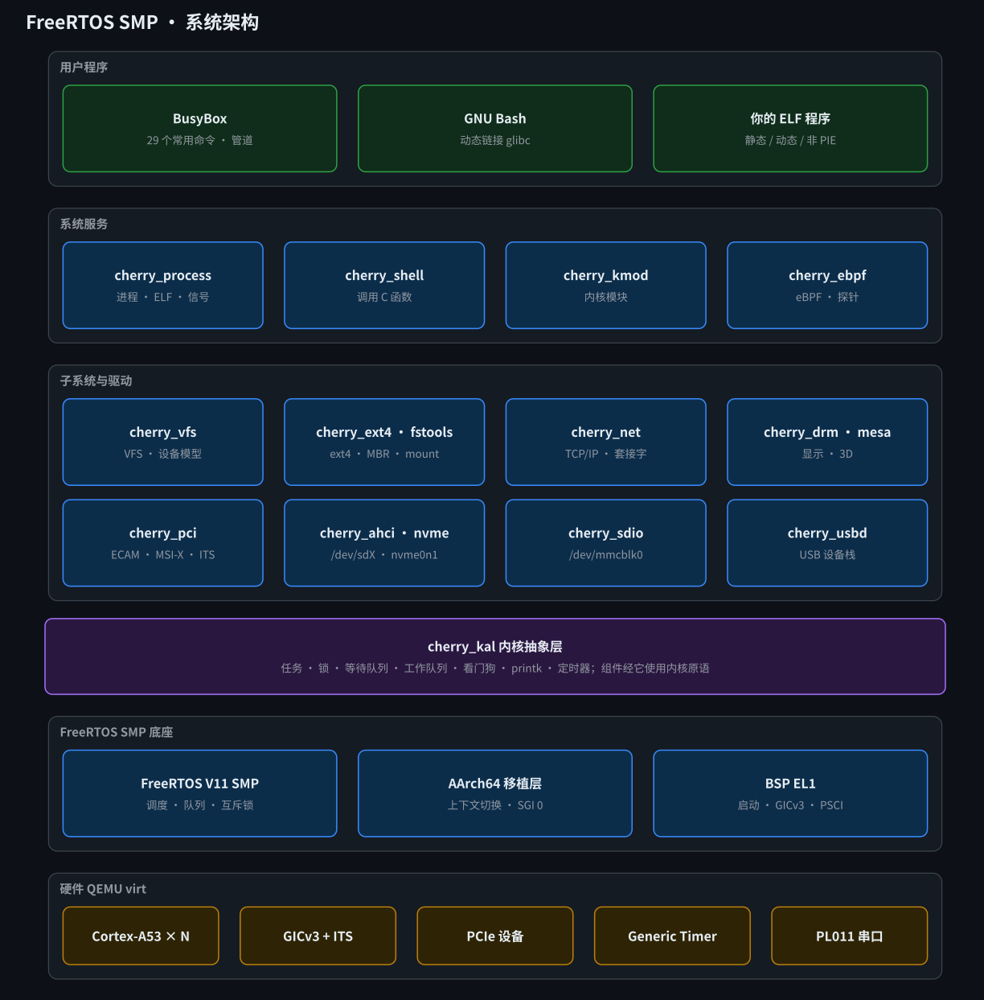
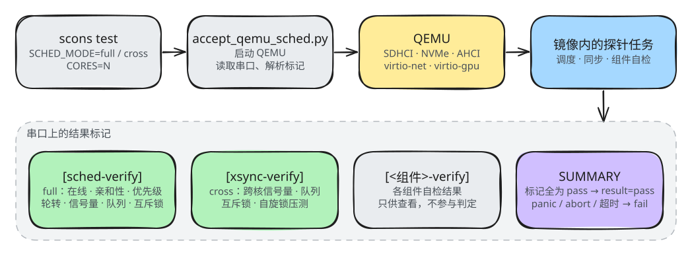

# FreeRTOS SMP for AArch64 · 技术博客

这个分支记录了在 ARMv8-A（Cortex-A53）和 QEMU `virt` 上从零移植 FreeRTOS SMP 的全过程：从裸机启动、异常与中断，到单核 FreeRTOS，再到 32 核 SMP。最后一步把底层原语抽成一个 arch 层，让 FreeRTOS、Little Kernel（LK）和 ThreadX 三个内核共用，并用同一套验收程序比较它们。

## 分支

| 分支 | 内容 |
| --- | --- |
| `master` | FreeRTOS SMP 内核、AArch64 移植层、arch 抽象层和 BSP，以及多核调度验收 |
| `cherry-vfs` | 加入第一批组件：`cherry_kal`、`cherry_printk`、`cherry_timer`、`cherry_vfs`、`cherry_shell` |
| `cherry-pci-sdio` | 再加入 `cherry_pci`（含 GICv3 ITS）和 `cherry_sdio` |
| `cherry-ext4-fstools` | 再加入 `cherry_ext4` 和 `cherry_fstools` |
| `vibe-coding-dev` | 组件拆成 18 个独立仓库（子模块），加入网络、NVMe、AHCI、进程与用户空间等 |
| `technical-blogs` | 从零移植的技术博客，以及 FreeRTOS、LK、ThreadX 共用 arch 层的对比实验 |

当前分支：**`technical-blogs`**。

## 博客

| 文档 | 内容 |
| --- | --- |
| [Phase 2（GICv2）](docs/phase2-异常向量表与GICv2中断.md) | 异常向量表、中断上下文、通用定时器 |
| [Phase 2（GICv3）](docs/phase2-GICv3中断与通用定时器.md) | ICC 系统寄存器、Group 1 非安全中断、Redistributor、EL2 降级 |
| [Phase 3](docs/phase3-FreeRTOS集成.md) | FreeRTOS 集成：TCB、上下文保存与恢复、SVC 与抢占调度 |
| [Phase 4](docs/phase4-FreeRTOS-SMP.md) | FreeRTOS SMP：SGI 0 跨核 Yield、自旋锁、PSCI 多核启动、32 核压测 |
| [单镜像架构](docs/unikernel-architecture.md) | 启动、BSP、内核、运行时与应用在一个 ELF 里的组织方式 |
| [演进记录](status.md) | SMP 调度器与 arch 抽象层的修改和调试记录 |

## 三个内核共用 arch 层

`arch/` 提供与内核无关的 AArch64 原语：核号与 MPIDR 映射、原子操作、屏障、原始 / 递归自旋锁、IRQ 注册与分发、异常记录、线程句柄和向量表安装。三个内核各自保留自己的调度器和上下文切换汇编，只把这些公共部分接到 arch 层上。

三个内核都带一个调度验收程序，打印同样的 `[sched-verify]` / `[xsync-verify]` 标记，由同一个 `tests/acceptance/accept_qemu_sched.py` 判定：

## 构建与运行

这个分支用 Make 构建。

| 目标 | 作用 |
| --- | --- |
| `make all` / `make run` | 构建 / 运行 FreeRTOS 镜像 |
| `make sched-full` / `make sched-cross` / `make sched-smp` | FreeRTOS 验收：full、跨核压测、两者都跑 |
| `make lk-kernel` / `make lk-run` / `make lk-sched-full` / `make lk-sched-smp` | LK 的构建、运行与验收 |
| `make threadx-kernel` / `make threadx-run` / `make threadx-sched-full` / `make threadx-sched-smp` | ThreadX 的构建、运行与验收 |
| `make arch-sched-matrix` | 依次跑三个内核的验收 |

公共选项：`CORES`（默认 2）、`TIMEOUT`、`SCHED_MODE`、`LOG_LEVEL`、`TICK_BROADCAST`。

依赖：

- FreeRTOS：`gcc-aarch64-linux-gnu`、`qemu-system-arm`、`python3`。
- ThreadX：`aarch64-none-elf-` 裸机工具链，以及 ThreadX 源码，路径由 `THREADX_SRC` 指定（默认指向作者本机的目录，需要按自己的环境设置）。

## 现状

这个分支停在博客写作时的状态，在当前环境（gcc 11.4、QEMU 10.2）上实测：

| 内核 | 结果 |
| --- | --- |
| FreeRTOS | 用 gcc 10 及以上链接失败：`kernel/Makefile`、`bsp/Makefile` 没有 `-mno-outline-atomics`，原子操作引用了 libgcc 的 `__aarch64_ldadd8_relax`。加上这个选项后能构建，但 2 核验收不通过。可运行的 FreeRTOS 请使用 `master` 分支。 |
| LK | `make lk-sched-full CORES=4` 通过；2 核时 `prio` 一项不通过。 |
| ThreadX | `CORES=4` 能构建运行，`sem`、`queue`、`mutex` 三项不通过。 |

## 许可证

本仓库的代码采用 MIT 许可证。`kernel/` 下的 FreeRTOS、`lk/` 下的 LK 和 ThreadX 源码保留各自的许可证与版权声明。
