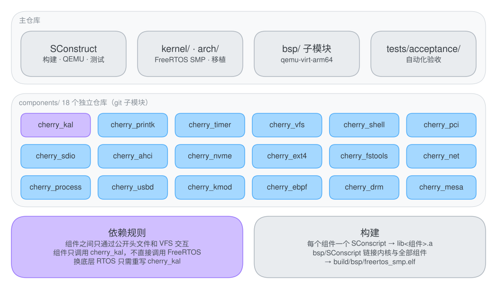

# FreeRTOS SMP for AArch64

[](LICENSE)
[](kernel)
[](docs/architecture.md)
[](docs/getting-started.md)

本仓库是运行在 AArch64 上的 FreeRTOS SMP 系统。FreeRTOS 只负责多核启动、中断和任务调度；文件系统、网络、存储驱动、进程模型、Shell 等操作系统能力都是独立的组件，各自一个仓库，通过内核抽象层 `cherry_kal` 接到内核上，可以按需组合。

在 QEMU `virt` 上，它能从 ext4 根文件系统启动 BusyBox 和动态链接的 GNU Bash。

<p align="center"></p>

## 分支

| 分支 | 内容 |
| --- | --- |
| `master` | FreeRTOS SMP 内核、AArch64 移植层、arch 抽象层和 BSP，以及多核调度验收 |
| `cherry-vfs` | 加入第一批组件：`cherry_kal`、`cherry_printk`、`cherry_timer`、`cherry_vfs`、`cherry_shell` |
| `cherry-pci-sdio` | 再加入 `cherry_pci`（含 GICv3 ITS）和 `cherry_sdio` |
| `cherry-ext4-fstools` | 再加入 `cherry_ext4` 和 `cherry_fstools` |
| `vibe-coding-dev` | 组件拆成 18 个独立仓库（子模块），加入网络、NVMe、AHCI、进程与用户空间等 |
| `technical-blogs` | 从零移植的技术博客，以及 FreeRTOS、LK、ThreadX 共用 arch 层的对比实验 |

当前分支：**`vibe-coding-dev`**。

## 特性

- **FreeRTOS V11 SMP 底座**：1–32 核 Cortex-A53，GICv3 中断，Generic Timer 时钟，PSCI 拉起从核，跨核 Yield 走 SGI。
- **组件化**：18 个组件各自一个 git 仓库，只依赖 `cherry_kal` 提供的任务、锁、等待队列、工作队列等原语，不直接调用 FreeRTOS。
- **存储**：PCIe ECAM 枚举、MSI-X（GICv3 ITS）；AHCI、NVMe、SD/eMMC 块设备；MBR 分区，ext4（带 JBD2 日志）以及 `mkfs` / `fsck`。
- **网络**：virtio-net 驱动，多队列 TCP/IP 协议栈，BSD 套接字。
- **进程与用户空间**：进程、`fork` / `execve` / `wait4` / `pipe`、信号、`mmap`，加载静态、动态和非 PIE 的 ELF，可运行 BusyBox 与 GNU Bash。
- **调试与扩展**：直接调用 C 函数的 Shell、内核模块加载、eBPF 虚拟机与探针、统一格式的多核日志。
- **自动化验收**：一条命令在 QEMU 上启动全部设备并检查调度、跨核同步和各组件的自检结果。

## 快速开始

需要 Ubuntu 20.04 或更新版本（实体机、虚拟机、WSL2 都可以）。

```bash
# 1. 安装依赖
sudo apt-get update
sudo apt-get install -y gcc-aarch64-linux-gnu g++-aarch64-linux-gnu qemu-system-arm \
                        python3 python3-pip e2fsprogs
pip3 install scons

# 2. 获取代码（组件是子模块，必须带 --recursive）
git clone --recursive -b vibe-coding-dev https://github.com/Surest-ok/FreeRTOS.git
cd FreeRTOS

# 3. 构建，生成 build/bsp/freertos_smp.elf
scons -j$(nproc)

# 4. 生成 Ubuntu 用户空间镜像 build/ubuntu_rootfs.ext4（GNU Bash 和验收测试都需要）
python3 scripts/build_ubuntu_rootfs.py

# 5. 在 QEMU 上运行（默认 2 核）
scons run
```

退出 QEMU：先按 `Ctrl+A`，松开后再按 `X`。

```bash
# 6. 运行自动化验收
scons test
```

完整的步骤、每一步的预期输出和常见问题见 [上手指南](docs/getting-started.md)。

## 架构一览

主仓库只包含 FreeRTOS SMP 内核、AArch64 移植层、BSP 和构建脚本；其余能力都在 `components/` 下的子模块里。

<p align="center"></p>

系统启动后先由 BSP 初始化串口、中断和定时器并拉起从核，然后按依赖顺序初始化各组件，最后挂载根文件系统：

<p align="center"></p>

存储与网络的分层、各组件的职责见 [架构说明](docs/architecture.md)。

## 组件

| 组件 | 作用 | 仓库 |
| --- | --- | --- |
| `bsp` | QEMU virt 板级支持：启动、GICv3、Generic Timer、PL011、平台设备 | [qemu-virt-arm64](https://github.com/Surest-ok/qemu-virt-arm64) |
| `cherry_kal` | 内核抽象层：任务、锁、等待队列、工作队列、看门狗 | [cherry_kal](https://github.com/Surest-ok/cherry_kal) |
| `cherry_printk` | 多核日志，每行完整输出不交错 | [cherry_printk](https://github.com/Surest-ok/cherry_printk) |
| `cherry_timer` | 每核定时器队列，`timer_list` 与高精度定时器 | [cherry_timer](https://github.com/Surest-ok/cherry_timer) |
| `cherry_vfs` | 虚拟文件系统、设备模型（字符 / 块 / 套接字设备）、`poll` / `epoll` / `select` | [cherry_vfs](https://github.com/Surest-ok/cherry_vfs) |
| `cherry_pci` | PCIe ECAM 枚举、BAR 分配、MSI / MSI-X（GICv3 ITS） | [cherry_pci](https://github.com/Surest-ok/cherry_pci) |
| `cherry_ahci` | SATA AHCI，多端口，`/dev/sda`、`/dev/sdb` | [cherry_ahci](https://github.com/Surest-ok/cherry_ahci) |
| `cherry_nvme` | NVMe，`/dev/nvme0n1` | [cherry_nvme](https://github.com/Surest-ok/cherry_nvme) |
| `cherry_sdio` | SD / SDIO / eMMC，SDHCI 控制器，`/dev/mmcblk0` | [cherry_sdio](https://github.com/Surest-ok/cherry_sdio) |
| `cherry_ext4` | ext4 文件系统、JBD2 日志、`mkfs` / `fsck` | [cherry_ext4](https://github.com/Surest-ok/cherry_ext4) |
| `cherry_fstools` | MBR 分区、`mount` / `umount` 等存储工具 | [cherry_fs](https://github.com/Surest-ok/cherry_fs) |
| `cherry_net` | 多队列 TCP/IP、virtio-net 驱动、BSD 套接字 | [cherry_net](https://github.com/Surest-ok/cherry_net) |
| `cherry_process` | 进程、POSIX 系统调用、ELF 加载与动态链接、BusyBox | [cherry_process](https://github.com/Surest-ok/cherry_process) |
| `cherry_shell` | 直接调用 C 函数的 Shell，地址与符号互查 | [cherry_shell](https://github.com/Surest-ok/cherry_shell) |
| `cherry_kmod` | 内核模块加载与符号重定位 | [cherry_kmod](https://github.com/Surest-ok/cherry_kmod) |
| `cherry_ebpf` | eBPF 虚拟机、校验器、map、探针 | [cherry_ebpf](https://github.com/Surest-ok/cherry_ebpf) |
| `cherry_usbd` | USB 设备栈：CDC-ACM、MSC、HID；在 QEMU 上用虚拟 UDC 环回 | [cherry_usbd](https://github.com/Surest-ok/cherry_usbd) |
| `cherry_drm` | DRM/KMS 显示：virtio-gpu，`/dev/dri/card0`、`/dev/fb0` | [cherry_drm](https://github.com/Surest-ok/cherry_drm) |
| `cherry_mesa` | 3D 图形：GBM、EGL、OpenGL ES 2.0，virgl 与软件光栅 | [cherry_mesa](https://github.com/Surest-ok/cherry_mesa) |

每个组件的接口和用法见各自仓库的 README，组件之间的关系见 [组件说明](docs/components.md)。

## 构建选项

选项写在 `scons` 命令行上，例如 `scons CORES=4 run`：

| 选项 | 默认值 | 说明 |
| --- | --- | --- |
| `CORES` | `2` | 核数，同时决定 FreeRTOS 的 `configNUMBER_OF_CORES` 和 QEMU 的 `-smp` |
| `SCHED_MODE` | `full` | 验收模式：`full`，或跨核压测 `cross`、`cross-sem`、`cross-queue`、`cross-mutex`、`cross-spin` |
| `LOG_LEVEL` | `6` | 日志级别 0–7，7 打开 SMP 诊断 |
| `TICK_BROADCAST` | `1` | 时钟中断是否广播到所有核 |
| `TIMEOUT` | `90` | 验收测试的超时，秒 |
| `CROSS_COMPILE` | `aarch64-linux-gnu-` | 交叉工具链前缀 |
| `BUILD_DIR` | `build` | 构建目录 |

`make` 是 `scons` 的一层薄封装：`make all`、`make run`、`make sched-full`、`make sched-cross`、`make clean`。

## 测试

```bash
scons test                     # 全功能验收：调度、同步与各组件自检
scons SCHED_MODE=cross test    # 跨核同步压测
scons CORES=4 test             # 换核数
```

<p align="center"></p>

判定规则和日志位置见 [测试](docs/testing.md)。

## 目录结构

```text
.
├── SConstruct          构建编排：组件、QEMU 运行与验收目标
├── Makefile            scons 的快捷封装
├── kernel/             FreeRTOS V11 SMP 内核（tasks.c、queue.c 等）与 AArch64 移植层（port/）
├── arch/               体系结构抽象：原子操作、自旋锁、屏障，以及编译规则（rules.py）
├── include/            内核配置（FreeRTOSConfig.h）与公共头文件
├── bsp/                板级支持包（子模块）
├── components/         18 个组件（子模块）
├── scripts/            Ubuntu 根文件系统构建、QEMU 启动脚本
├── tests/acceptance/   自动化验收脚本
└── docs/               文档与插图
```

## 现状与限制

- 只在 QEMU `virt` 上运行过，还没有在实体板卡上验证。
- Ubuntu 用户空间镜像只包含 Bash 及其依赖库，由 `scripts/build_ubuntu_rootfs.py` 在本机生成，需要能访问 `ports.ubuntu.com`。
- QEMU 以 `-nographic` 启动，看不到图形输出，显示和 3D 组件靠自检和 Shell 命令验证；QEMU `virt` 没有 USB 设备控制器，`cherry_usbd` 在虚拟 UDC 上环回运行。

## 文档

| 文档 | 内容 |
| --- | --- |
| [上手指南](docs/getting-started.md) | 环境、获取代码、构建、运行、验收、常见问题 |
| [架构说明](docs/architecture.md) | 分层、启动流程、存储与网络栈、中断与多核 |
| [组件说明](docs/components.md) | 组件的依赖关系、怎样新增一个组件 |
| [测试](docs/testing.md) | 验收模式、判定规则、日志 |

## 许可证

[MIT](LICENSE)。`kernel/` 下的 FreeRTOS 内核源码同样采用 MIT 许可证，版权归其原作者所有。
