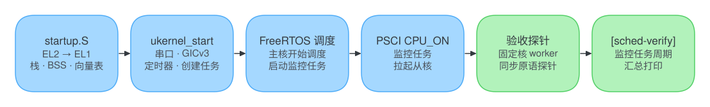

# FreeRTOS SMP for AArch64

[](LICENSE)
[](kernel)
[](arch)
[](#构建与运行)

在 ARMv8-A（Cortex-A53）和 QEMU `virt` 上运行的 FreeRTOS V11 SMP。仓库包含内核、AArch64 SMP 移植层、与内核无关的 arch 抽象层、板级支持包和 SCons 构建，并带有一套在 QEMU 上自动运行的多核调度验收。

## 架构

<p align="center"></p>

- **FreeRTOS V11 SMP**：1–32 核，任务亲和性、优先级抢占、同优先级时间片轮转，队列、信号量、互斥锁。
- **AArch64 SMP 移植**：上下文保存与恢复、每核异常栈，跨核 Yield 走 GICv3 SGI 0。
- **arch 抽象层**：核号与 MPIDR 映射、内联 LL/SC 原子操作、屏障、原始 / 递归自旋锁、IRQ 注册与分发、异常记录。
- **BSP**：EL2 → EL1 启动，GICv3（系统寄存器接口）、Generic Timer（1000 Hz）、PL011 串口，PSCI `CPU_ON` 拉起从核。

## 启动流程

<p align="center"></p>

## 构建与运行

```bash
# 1. 安装依赖（Ubuntu 20.04 或更新版本，实体机、虚拟机、WSL2 都可以）
sudo apt-get update
sudo apt-get install -y gcc-aarch64-linux-gnu qemu-system-arm python3 python3-pip
pip3 install scons            # 装在 ~/.local/bin，确认它在 PATH 里

# 2. 获取代码
git clone https://github.com/Surest-ok/FreeRTOS.git
cd FreeRTOS

# 3. 构建，生成 build/bsp/freertos_smp.elf 和 freertos_smp.bin
scons -j$(nproc)

# 4. 在 QEMU 上运行（默认 2 核）
scons run
```

退出 QEMU：先按 `Ctrl+A`，松开后再按 `X`。

常用选项：`CORES`（核数，默认 2，最多 32）、`SCHED_MODE`（`full` 或 `cross`）、`LOG_LEVEL`（0–7，7 打开 SMP 诊断）、`TICK_BROADCAST`（0 / 1）。例如 `scons CORES=4 run`。`make` 是 `scons` 的薄封装：`make run`、`make sched-full`、`make sched-cross`、`make clean`。

## 验收

```bash
scons test                     # 调度、亲和性、优先级、轮转与同步原语
scons SCHED_MODE=cross test    # 跨核信号量、队列、互斥锁、自旋锁压测
```

<p align="center"></p>

通过时的最后两行：

```text
freertos: [sched-verify] active=PASS idle=PASS affinity=PASS coverage=PASS progress=PASS prio=PASS rr=PASS sem=PASS queue=PASS mutex=PASS spin=PASS cores=2 ...
[SCHED-TEST] SUMMARY result=PASS mode=full cores=2 markers=2
```

`[sched-verify]` 各项的含义：

| 项 | 通过条件 |
| --- | --- |
| `active` | 所有核都已由 PSCI 拉起并完成初始化 |
| `idle` | 空闲任务的状态符合预期 |
| `affinity` | 固定核的 worker 没有跑到别的核上 |
| `coverage` | 每个核都运行过应用任务 |
| `progress` | 各核的 heartbeat 持续增长 |
| `prio` | 高优先级任务能抢占低优先级任务 |
| `rr` | 同优先级任务按时间片轮转 |
| `sem` / `queue` / `mutex` / `spin` | 同步原语工作正常，没有死锁和竞态 |

## 目录结构

```text
.
├── SConstruct            构建编排：内核、arch、BSP，QEMU 运行与验收目标
├── Makefile              scons 的快捷封装
├── kernel/               FreeRTOS V11 SMP 内核、MemMang/、port/（AArch64 SMP 移植）
├── arch/                 arch 抽象层：include/arch_api/ 接口、aarch64/arch.c 实现、rules.py 编译规则
├── include/              FreeRTOSConfig.h、portmacro.h 与板级公共头文件
├── bsp/                  startup.S、GICv3、定时器、PL011、验收探针（src/app.c）
├── scripts/              直接启动 QEMU 的脚本
├── tests/acceptance/     验收脚本 accept_qemu_sched.py
└── docs/images/          插图
```

在这份代码上加入文件系统、网络、存储驱动、进程模型等组件的版本在 [`vibe-coding-dev`](https://github.com/Surest-ok/FreeRTOS/tree/vibe-coding-dev) 分支。

## 许可证

[MIT](LICENSE)。`kernel/` 下的 FreeRTOS 内核源码同样采用 MIT 许可证，各文件保留其原始版权声明。
