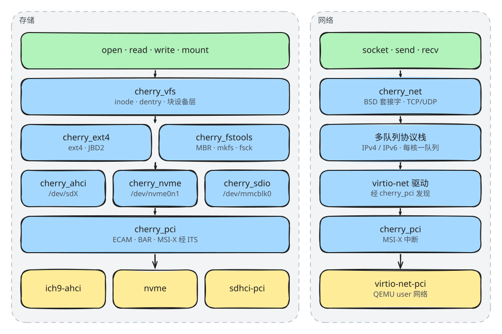

# 架构说明

## 分层

| 层 | 内容 | 位置 |
| --- | --- | --- |
| 用户程序 | BusyBox、GNU Bash、自己的 ELF 程序，通过 POSIX 系统调用进入系统 | 根文件系统镜像、`cherry_process/data` |
| 系统服务 | 进程与 ELF 加载、Shell、内核模块、eBPF | `components/` |
| 子系统 | VFS 与设备模型、ext4 与存储工具、TCP/IP、显示与 3D、USB 设备栈 | `components/` |
| 设备驱动 | PCIe、AHCI、NVMe、SD/eMMC、virtio-net | `components/` |
| 内核抽象层 | `cherry_kal`：任务、锁、信号量、等待队列、工作队列、看门狗、时间，以及 `printk`（由 `cherry_printk` 实现） | `components/cherry_kal` |
| FreeRTOS SMP 底座 | FreeRTOS V11 SMP 内核、AArch64 移植层、体系结构原语、BSP | `kernel/`、`arch/`、`bsp/` |

上层只依赖下层。除 `cherry_kal` 外，组件都不包含 FreeRTOS 的头文件；`cherry_kal` 把 FreeRTOS 的接口包装成统一的内核原语（`kal_mutex_*`、`kal_sem_*`、`kal_spin_*`、`kal_thread_*` 等）。所以组件可以单独移植到其他 RTOS，只需要重写 `cherry_kal`。

## 模块组织

- 主仓库包含 `SConstruct`、`kernel/`、`arch/`、`include/`、`tests/` 和 `scripts/`。
- `bsp/` 和 `components/` 下的 18 个组件都是 git 子模块，各自独立开发、独立发布。
- 每个组件提供一个 `SConscript`，编译成静态库；`bsp/SConscript` 把 FreeRTOS 内核、BSP 和全部组件库链接成 `build/bsp/freertos_smp.elf`。

## 启动流程

1. **`bsp/src/startup.S`**：QEMU 从 EL2（`virtualization=on` 时）或 EL1 进入。在 EL2 时设置好后降到 EL1；随后每个核按 `MPIDR` 选自己的栈，清零 BSS，设置向量表。
2. **`ukernel_start`**（`bsp/src/ukernel.c`）：初始化 PL011 串口和日志，初始化 GICv3 与 Generic Timer，创建任务后主核开始 FreeRTOS 调度。
3. **拉起从核**：监控任务用 PSCI `CPU_ON` 启动其余的核，它们进入同一个调度器。
4. **组件初始化**（`bsp/src/app.c`）：监控任务按依赖顺序调用 `cherry_<组件>_init()`，每个组件初始化后立即运行自己的自检（`cherry_<组件>_run_tests()`）。存储组件就绪后，若 `/dev/sdb` 上有 Ubuntu 镜像，就把它挂到 `/`，再把 devfs 挂到 `/dev`。
5. **Shell**：最后 `cherry_shell_start()` 在串口上启动交互 Shell。

板级硬件资源（GICv3、Arch Timer、PCIe ECAM）由 `bsp_register_platform_devices()` 注册成平台设备，驱动通过 `cherry_vfs` 的设备模型拿到它们，不直接引用板级地址。

## 多核与中断

- 核数在编译时由 `CORES` 决定（FreeRTOS 的 `configNUMBER_OF_CORES`），QEMU 用同样的 `-smp`。
- 中断控制器是 GICv3，CPU 接口走系统寄存器。PCIe 设备的 MSI / MSI-X 经 GICv3 ITS 转成 LPI。
- 时钟中断来自 Generic Timer；`TICK_BROADCAST=1` 时广播到所有核。
- 跨核让出处理器（Yield）用 SGI 0。
- 任务可以用 `xTaskCreateAffinitySet` 绑定到指定的核，验收中的亲和性探针就是这样创建的。

## 存储与网络

**存储**：

- `cherry_pci` 经 ECAM 枚举 PCIe 设备、分配 BAR、配置 MSI-X，并把设备交给注册了对应 ID 的驱动。
- `cherry_ahci`、`cherry_nvme`、`cherry_sdio` 把磁盘注册成块设备：`/dev/sda`、`/dev/sdb`、`/dev/nvme0n1`、`/dev/mmcblk0`。
- `cherry_fstools` 解析 MBR 分区（如 `/dev/mmcblk0p1`），提供 `mount` / `umount` 与通用的 `mkfs` / `fsck` 入口；`cherry_ext4` 向它注册 ext4 的实现。
- `cherry_vfs` 提供 inode / dentry、挂载表和块设备层，用户程序通过 `open` / `read` / `write` 访问。

**网络**：

- `cherry_net` 包含 virtio-net 驱动和 TCP/IP 协议栈（TCP、UDP、IPv4、IPv6），收发按核分队列。
- 套接字以 VFS 中的套接字设备出现，用户程序使用标准 BSD 套接字接口。
- QEMU 使用 user 网络，客户机可以访问外部网络，但外部不能主动连进来。

## 进程与用户空间

`cherry_process` 实现进程模型和 POSIX 系统调用：

- 进程创建与回收：`fork`、`execve`、`wait4`，以及 `pipe`、文件描述符、`brk` / `mmap` / `munmap`、实时信号。
- ELF 加载：静态、动态（解析 `PT_INTERP`，加载 `ld-linux-aarch64.so.1`、`libc.so.6`）、非 PIE。
- 用户指针统一经过访问检查（UAccess），进程地址空间按 VMA 管理。
- 内置 BusyBox（`cherry_process/data/busybox.elf`），Ubuntu 镜像提供 GNU Bash。

## 调试设施

- **`cherry_printk`**：所有核共用的日志，每一行在关中断下整体入队，再异步输出，不会和其他核的输出交错。`LOG_LEVEL` 控制输出级别。
- **`cherry_shell`**：在串口上直接按名字调用内核里的 C 函数并传参，支持地址与符号互查（`addr2sym`）。
- **`cherry_kmod`**：在运行时加载内核模块并完成符号重定位。
- **`cherry_ebpf`**：eBPF 虚拟机、校验器和 map，可以挂在系统调用、调度、中断、VFS 等探针上。
