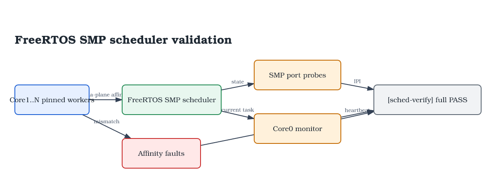

# Phase 4: FreeRTOS SMP 多核支持 — 32 核调度边界与 IPI

## 1. 目标

在 Phase 3（FreeRTOS V11.x 单核抢占式调度）的基础上，扩展为 SMP 多核支持：

1. **多核启动** — Core 0 做主初始化，Core 1..N 通过邮箱机制等待启动
2. **SMP 调度** — 多个核心共享就绪队列，自动分配任务到各核心
3. **自旋锁保护** — Task Lock + ISR Lock 保护内核数据结构
4. **核间中断 (IPI)** — SGI 0 用于跨核心触发上下文切换
5. **核心亲和性** — 验证 `vTaskCoreAffinitySet()` 将任务绑定到特定核心
6. **每核外设初始化** — GICv3 Redistributor (GICR) 按核心 ID 访问
7. **32 核边界修复** — 修正 MPIDR 线性 core id、SGI target list、调度位图和链接脚本容量

默认目标：`make run` 使用 `-smp 2` 快速验证；扩展目标：`make CORES=32 run` 构建 32 核镜像并在 QEMU GICv3 拓扑下验证多核调度。

构建产物按核数隔离到 `kernel/build-$(CORES)`、`bsp/build-$(CORES)` 和 `bsp/kernel-$(CORES).elf`，避免 2 核和 32 核对象文件或 ELF 互相复用。

---

## 2. 架构总览

```
┌──────────────────────────────────────────────────────────────────┐
│                     FreeRTOS SMP on QEMU virt                    │
│                                                                   │
│  应用层                                                           │
│  ┌──────────────┐  ┌──────────────┐  ┌──────────────┐            │
│  │ pinned worker│  │ pinned worker│  │ monitor task │            │
│  │ core 0       │  │ core 1..N-1  │  │ core 0       │            │
│  │ heartbeat    │  │ heartbeat    │  │ PASS/FAIL    │            │
│  └──────────────┘  └──────────────┘  └──────────────┘            │
│       │                 │                 │                       │
│       ▼                 ▼                 ▼                       │
│  ┌─────────────────────────────────────────────┐                 │
│  │      FreeRTOS V11.x SMP 内核               │                 │
│  │  pxCurrentTCBs[N] / affinity / ready lists  │                 │
│  │  vTaskSwitchContext(xCoreID) + idle probe   │                 │
│  │  vTaskEnterCritical()  → Task + ISR Lock   │                 │
│  └──────────────────┬──────────────────────────┘                 │
│                     │                                              │
│  ┌──────────────────▼──────────────────────────┐                 │
│  │        SMP 移植层 (kernel/port/)             │                 │
│  │  port_smp.h  — 自旋锁 / IPI / 临界区宏      │                 │
│  │  port_smp.c  — 自旋锁 / IPI / active probe  │                 │
│  │  port.c      — 每核状态数组 / Tick ISR 临界区│                 │
│  │  portASM.S   — pxCurrentTCBs[] 上下文切换    │                 │
│  └──────────────────┬──────────────────────────┘                 │
│                     │                                              │
│  ┌──────────────────▼──────────────────────────┐                 │
│  │         BSP (bsp/src/)                      │                 │
│  │  startup.S — 多核启动 / 邮箱 / 每核异常栈    │                 │
│  │  gic.c     — 每核 GICR PPI/SGI 操作          │                 │
│  │  gtimer.c  — Core 0 专属 Tick 定时器         │                 │
│  │  uart.c    — SMP 安全输出 (自旋锁)           │                 │
│  └──────────────────┬──────────────────────────┘                 │
│                     │                                              │
│  ┌──────────────────▼──────────────────────────┐                 │
│  │           QEMU virt (N× cortex-a53)          │                 │
│  │  GICv3 + EL1 Physical Timer + PL011 UART    │                 │
│  └─────────────────────────────────────────────┘                 │
└──────────────────────────────────────────────────────────────────┘
```

**多核启动流程**：

```
Core 0 (primary):                          Core 1..N (secondary):
  _start                                      _start
    ├─ MPIDR_EL1.Aff0=0 → keep                ├─ MPIDR_EL1.Aff0≠0 → park_secondary
    ├─ EL2→EL1 drop (if needed)                ├─ EL2→EL1 drop (if needed)
    ├─ setup_stack_el1 (linear id 0)           ├─ wait_for_mailbox:
    ├─ clear BSS                                   ├─ ldr secondary_entry[linear_id]
    ├─ main()                                      ├─ NULL → wfe
    │   ├─ uart_init()                             ├─ got entry → setup_stack_el1
    │   ├─ gic_init(0)                             ├─ br → vPortSecondaryCoreEntry()
    │   ├─ xTaskCreate × configNUMBER_OF_CORES     │     ├─ wait pxCurrentTCBs ≠ NULL
    │   ├─ secondary_entry[1..N-1] = entry          │     ├─ gic_init(linear_id)
    │   ├─ sev → wake core 1                       │     ├─ enable SGI 0
    │   └─ vTaskStartScheduler()                   │     └─ vPortRestoreTaskContext()
    │       ├─ prvCreateIdleTasks()                 │         └─ ERET → prvIdleTask
    │       │   └─ pxCurrentTCBs[1] = idle                └─ SVC → vTaskSwitchContext(1)
    │       └─ xPortStartScheduler()                           └─ pick SmpA/SmpB
    │           ├─ configSETUP_TICK_INTERRUPT()
    │           └─ vPortRestoreTaskContext()
    └───────────────┴─────────────────────────────────────────────
```

---

## 3. SMP 移植设计

### 3.1 关键设计决策

| 决策 | 选择 | 理由 |
|------|------|------|
| 端口文件位置 | `kernel/port/` (替代内核 port.c/portASM.S) | 不修改内核源码 |
| 临界区嵌套 | `portCRITICAL_NESTING_IN_TCB = 1` | 内核在 TCB 中管理嵌套计数 |
| Tick 驱动核 | 仅 Core 0 | Generic Timer PPI 30, 其他核心通过 IPI 唤醒 |
| 自旋锁类型 | C11 CAS raw lock + recursive lock | UART 用 raw lock；Task/ISR lock 支持同核递归 |
| 从核唤醒机制 | 邮箱 + WFE/SEV | 从核休眠，避免 32 个 vCPU 在 TCG 下抢占 Core 0 初始化时间 |
| 内核堆 | 链接器脚本定义 `ucHeap` (BSS 内) | 保证清零和 16 字节对齐 |
| 32 核 core id | `Aff1 * 16 + Aff0` | QEMU virt + GICv3 每个 Aff1 cluster 最多 16 个 Aff0 target-list bit |
| IPI 编码 | SGI1R `Aff1 + TargetList[15:0]` | `1 << (16 + core)` 只能覆盖 0..15，不能直接发送给 core 16..31 |
| CPU 状态 mask | active + idle + seen + heartbeat | IPI 只发 active 非本核目标；idle/seen/heartbeat 用于区分“核心在线”“跑 idle”“应用任务真正前进” |
| 链接脚本容量 | 栈/mailbox 固定预留 32 核 | 默认仍可 2 核运行，32 核构建不越界 |

### 3.2 目录结构

```
freertos-workspace/
├── kernel/                    # FreeRTOS 内核 → libfreertos.a
│   ├── port/
│   │   ├── port.c             # SMP 修改版 port.c
│   │   ├── portASM.S          # SMP 修改版上下文切换
│   │   └── port_smp.c         # 自旋锁 / IPI / 从核入口
│   ├── portable/GCC/ARM_AARCH64_SRE/
│   │   └── portmacro.h        # 原始 portmacro.h (被 include/portmacro.h 覆盖)
│   ├── MemMang/heap_4.c       # 堆管理
│   └── {tasks,queue,list,timers,...}.c  # 内核源码
├── bsp/                       # 板级支持包
│   ├── src/{main,startup,gic,gtimer,uart,...}.c
│   ├── linker.ld              # 链接脚本
│   └── Makefile
├── include/                   # 共享配置 + 端口头
│   ├── FreeRTOSConfig.h
│   ├── port_smp.h             # SMP 端口宏
│   ├── portmacro.h            # 覆盖内核 portmacro.h
│   └── stddef.h / stdlib.h / stdarg.h
└── Makefile                   # 顶层 Makefile
```

---

## 4. 代码详解

### 4.1 SMP 端口宏 — include/port_smp.h

**内核 ID 获取**：
从 `MPIDR_EL1` 读取亲和性字段，并转换为 FreeRTOS 使用的线性 core id。GICv3 SGI target list 每个 affinity level 只能表示 16 个 Aff0 目标，因此 QEMU virt 在 32 核时会跨 Aff1 cluster：

```c
#define portGET_CORE_ID()    ({ \
    unsigned long _mpidr; \
    __asm__ volatile("mrs %0, mpidr_el1" : "=r"(_mpidr)); \
    (int)((_mpidr & 0xFFUL) + (((_mpidr >> 8) & 0xFFUL) << 4)); \
})
```

不能只取 Aff0，否则 core 16..31 会和 core 0..15 共享 `pxCurrentTCBs[]`、`ulPortYieldRequireds[]`、GICR frame 等数组索引。

**自旋锁数据结构**：
```c
typedef struct {
    volatile unsigned int owner;   /* 0 = unlocked, core_id+1 = owner */
    volatile unsigned int count;   /* recursive depth */
} Spinlock_t;

typedef struct {
    volatile unsigned int value;   /* 0 = unlocked, 1 = locked */
} RawSpinlock_t;
```

owner 为 0 时表示未锁定。owner = core_id + 1 时表示被该核心持有。count 支持递归重入。
`RawSpinlock_t` 用于 UART 这类不需要递归语义的短临界区，避免把 console 输出绑定到 FreeRTOS task/ISR lock 状态。

**自旋锁 API**：
```c
#define portGET_TASK_LOCK(x)       vPortRecursiveLockAcquire(&xTaskSpinlock)
#define portRELEASE_TASK_LOCK(x)   vPortRecursiveLockRelease(&xTaskSpinlock)
#define portGET_ISR_LOCK(x)        vPortRecursiveLockAcquire(&xISRSpinlock)
#define portRELEASE_ISR_LOCK(x)    vPortRecursiveLockRelease(&xISRSpinlock)
```

**IPI (核间中断)**：
```c
extern void vPortYieldCore(long xCoreID);
#define portYIELD_CORE(x)          vPortYieldCore(x)
```

`vPortYieldCore()` 必须按 GICv3 `ICC_SGI1R_EL1` 编码目标：低 16 位是同一个 Aff1 下的 TargetList，Aff1 放在 `[23:16]`。这也是 32 核调度的关键修复之一：

```c
void vPortYieldCore(BaseType_t xCoreID)
{
    uint64_t aff1 = ((uint64_t)xCoreID >> 4) & 0xFFULL;
    uint64_t target_list = 1ULL << ((uint64_t)xCoreID & 0xFULL);
    uint64_t v = (aff1 << 16) | target_list; /* SGI 0 */
    __asm__ volatile("msr S3_0_C12_C11_5, %0\nisb\n" :: "r"(v) : "memory");
}
```

**临界区重定向**：
```c
#define portCRITICAL_NESTING_IN_TCB    1  /* 内核在 TCB 中管理嵌套计数 */

#define portENTER_CRITICAL_FROM_ISR()   vTaskEnterCriticalFromISR()
#define portEXIT_CRITICAL_FROM_ISR(x)   vTaskExitCriticalFromISR(x)
```

### 4.2 自旋锁实现 — kernel/port/port_smp.c

**获取锁 (C11 原子操作)**：
```c
void vPortRecursiveLockAcquire(Spinlock_t *pxLock)
{
    uint32_t core = (uint32_t)portGET_CORE_ID();
    uint32_t owner_plus1 = core + 1;

    /* 检查是否已持有 (递归重入) */
    if (__atomic_load_n(&pxLock->owner, __ATOMIC_ACQUIRE) == owner_plus1) {
        pxLock->count++;
        return;
    }

    /* 自旋等待锁释放 */
    for (;;) {
        while (__atomic_load_n(&pxLock->owner, __ATOMIC_RELAXED) != 0)
            __asm__ volatile("yield");

        /* CAS 获取锁：只有 owner 仍为 0 时才写入 owner_plus1 */
        uint32_t expected = 0;
        if (__atomic_compare_exchange_n(&pxLock->owner, &expected, owner_plus1,
                                        0, __ATOMIC_ACQ_REL, __ATOMIC_RELAXED)) {
            pxLock->count = 1;
            return;
        }
    }
}
```

**Raw lock (UART)**：
```c
void vPortRawSpinLockAcquire(RawSpinlock_t *pxLock)
{
    for (;;) {
        uint32_t expected = 0U;
        if (__atomic_compare_exchange_n(&pxLock->value, &expected, 1U,
                                        0, __ATOMIC_ACQUIRE, __ATOMIC_RELAXED))
            return;
        __asm__ volatile("yield");
    }
}

void vPortRawSpinLockRelease(RawSpinlock_t *pxLock)
{
    __atomic_store_n(&pxLock->value, 0U, __ATOMIC_RELEASE);
}
```

不要用 `__atomic_exchange_n()` 实现抢锁：失败核心会把 owner 覆盖成自己，等价于偷锁。UART 和内核锁现在都使用 CAS。

**释放锁**：
```c
void vPortRecursiveLockRelease(Spinlock_t *pxLock)
{
    pxLock->count--;
    if (pxLock->count == 0) {
        __atomic_store_n(&pxLock->owner, 0, __ATOMIC_RELEASE);
    }
}
```

**从核入口**：
```c
void vPortSecondaryCoreEntry(void)
{
    BaseType_t core_id = portGET_CORE_ID();

    /* 等待调度器就绪 — 自旋直到 pxCurrentTCBs[core_id] 被设置 */
    extern void * volatile pxCurrentTCBs[];
    while (pxCurrentTCBs[core_id] == NULL)
        __asm__ volatile("dmb sy" ::: "memory");

    /* 初始化本核 GIC Redistributor */
    gic_init((uint32_t)core_id);

    /* 使能 SGI 0 接收 IPI */
    gic_set_priority(0, 0xB0);
    gic_enable_irq(0);
    app_irq_install(0, SGI_Yield_Handler);

    /* 使能 IRQ */
    __asm__ volatile("msr daifclr, #2\n" "isb\n");

    /* 安装向量表，恢复第一个任务 */
    vPortRestoreTaskContext();
}
```

**SGI Yield 处理**：
```c
void SGI_Yield_Handler(void)
{
    BaseType_t core_id = portGET_CORE_ID();

    /* 清除本地 GICR 中 SGI 0 的 pending 状态 */
    volatile uint32_t *icpendr0 = (volatile uint32_t *)
        ((uint64_t)0x080A0000 + (uint64_t)core_id * 0x20000 + 0x1100);
    *icpendr0 = (1 << 0);

    /* 标记该核心需要上下文切换 */
    ulPortYieldRequireds[core_id] = 1;
}
```

### 4.3 SMP 端口 C 层 — kernel/port/port.c

**关键修改** — 单核全局变量替换为每核数组：

```c
/* 声明在 port_smp.c 中定义的每核数组 (替代原来的单值变量) */
extern unsigned long ulPortInterruptNestings[];
extern unsigned long ulPortYieldRequireds[];
extern unsigned long ulPortTaskHasFPUContexts[];

/* ullCriticalNesting — 删除, 由内核在 TCB 中管理 (portCRITICAL_NESTING_IN_TCB=1) */
```

**`pxPortInitialiseStack` — 栈帧布局匹配**：

portCRITICAL_NESTING_IN_TCB=1 时，临界嵌套计数不保存在栈上。但 `portSAVE_CONTEXT` 使用 `STP X2, XZR` 保存 FPU 指示器 + 填充，需要栈帧初始布局与之匹配：

```c
StackType_t *pxPortInitialiseStack(StackType_t *pxTopOfStack,
                                   TaskFunction_t pxCode, void *pvParameters)
{
    // ... X0-X30, SPSR, ELR ...
    
    /* FPU context indicator — no FPU context for this task. */
    pxTopOfStack--;
    *pxTopOfStack = portNO_FLOATING_POINT_CONTEXT;
    
    /* Padding slot to match portSAVE_CONTEXT's STP X2, XZR layout */
    pxTopOfStack--;
    *pxTopOfStack = (StackType_t)0;
    
    return pxTopOfStack;
}
```

**`FreeRTOS_Tick_Handler` — SMP ISR 临界区**：

Tick 中断处理必须使用 `taskENTER_CRITICAL_FROM_ISR()` 进入 ISR 临界区，因为 SMP 内核的 `xTaskIncrementTick()` 会调用 `prvYieldForTask()`，该函数要求临界嵌套计数 > 0：

```c
void FreeRTOS_Tick_Handler(void)
{
    // ... 屏蔽中断到 max syscall priority ...

    #if (configNUMBER_OF_CORES > 1)
    {
        UBaseType_t uxSavedStatus = taskENTER_CRITICAL_FROM_ISR();
        if (xTaskIncrementTick() != pdFALSE)
            ulPortYieldRequireds[core_id] = pdTRUE;
        taskEXIT_CRITICAL_FROM_ISR(uxSavedStatus);
    }
    #endif

    // ... 恢复中断 ...
}
```

### 4.4 SMP 上下文切换 — kernel/port/portASM.S

**关键修改** — `pxCurrentTCBs[]` 数组索引：

```asm
/* 原 (单核): pxCurrentTCB = 单个指针 */
/* 新 (SMP):  pxCurrentTCBs[core_id] = 每核 TCB */

/* 宏：获取核心 ID 到 Xreg */
.macro GET_CORE_ID Xreg
    MRS     \Xreg, MPIDR_EL1
    AND     \Xreg, \Xreg, #0xFF
    MRS     X17, MPIDR_EL1
    UBFX    X17, X17, #8, #8
    ADD     \Xreg, \Xreg, X17, LSL #4
.endm

/* portSAVE_CONTEXT 中保存 SP */
    GET_CORE_ID  X0
    LDR     X1, =pxCurrentTCBs
    LDR     X1, [X1, X0, LSL #3]     /* X1 = pxCurrentTCBs[core_id] */
    MOV     X0, SP
    STR     X0, [X1]                  /* pxTopOfStack = SP */
```

**`vTaskSwitchContext` 签名变更**：

```asm
/* 原 (单核): BL vTaskSwitchContext */
/* 新 (SMP):  传递核心 ID 参数 */

    GET_CORE_ID  X0
    BL      vTaskSwitchContext       /* void vTaskSwitchContext(BaseType_t xCoreID) */
```

**`portRESTORE_CONTEXT` 恢复**：

从 `pxCurrentTCBs[core_id]` 加载 `pxTopOfStack`，恢复完整上下文。PMR 设置为 0xFF (不屏蔽)，因为 `portCRITICAL_NESTING_IN_TCB=1` 时内核通过 TCB 管理临界嵌套。

### 4.5 多核启动 — bsp/src/startup.S

**每核异常栈**：

```asm
#define STACK_SIZE 8192

.macro GET_LINEAR_CORE_ID Xreg, Xtmp
    mrs     \Xtmp, MPIDR_EL1
    and     \Xreg, \Xtmp, #0xFF       /* Aff0 */
    ubfx    \Xtmp, \Xtmp, #8, #8      /* Aff1 */
    add     \Xreg, \Xreg, \Xtmp, lsl #4
.endm

/* setup_stack_el1: SP_EL1 = stack_top + (linear_core_id * STACK_SIZE) */
setup_stack_el1:
    GET_LINEAR_CORE_ID x6, x9
    ldr     x20, =stack_top
    mov     x7, #STACK_SIZE
    madd    x20, x6, x7, x20
    msr     spsel, #1
    mov     sp, x20
    ret
```

**从核邮箱启动**：

```asm
/* Core 1+: 从邮箱读取入口地址，WFE 等待 */
park_secondary:
    mrs     x10, CurrentEL
    // ... EL2→EL1 drop if needed ...

wait_for_mailbox:
    GET_LINEAR_CORE_ID x6, x9
    ldr     x7, =secondary_entry
    add     x7, x7, x6, lsl #3          /* x7 = &secondary_entry[linear_id] */
1:  ldr     x8, [x7]
    cbnz    x8, 1f
    wfe
    b       1b
1:  dmb     sy

    /* 获得入口点 → 设置栈 → 配置 EL1 → 启用 IRQ → 跳转 */
    bl      setup_stack_el1
    /* ... 配置 CPACR_EL1, SCTLR_EL1 ... */
    msr     daifclr, #0x2                /* 启用 IRQ */
    br      x8                           /* 跳转到 vPortSecondaryCoreEntry */
```

**Core 0 端 (bsp/src/main.c)**：

```c
/* 写入邮箱 → DMB 确保可见 → SEV 唤醒从核 */
for (int i = 1; i < configNUMBER_OF_CORES; i++)
    secondary_entry[i] = vPortSecondaryCoreEntry;
__asm__ volatile("dmb sy\nsev" ::: "memory");
```

### 4.6 链接脚本 — bsp/linker.ld

**堆在 BSS 内** (确保清零和 16 字节对齐)：

```ld
.bss :
{
    __bss_start = .;
    *(.bss*)
    *(COMMON)
    . = ALIGN(16);
    ucHeap = .;
    . = . + (256 * 1024);                /* configTOTAL_HEAP_SIZE */
    __bss_end = .;
}

/* 每核异常栈 — 在 BSS 之上 */
.stack (NOLOAD) :
{
    . = ALIGN(16);
    stack_top = .;
    . = . + (8192 * 32);                 /* 最大 32 核 × 8KB */
}

/* 从核邮箱 — 在栈之上 */
.mailbox (NOLOAD) :
{
    . = ALIGN(8);
    secondary_entry = .;
    . = . + (8 * 32);                    /* 最大 32 核 × 8 字节 */
}
```

堆放在 BSS 内是关键设计：BSS 由启动代码清零 (`clear_bss` 循环)，确保堆的初始状态为全零，这是 heap_4.c 正确初始化的必要前提。

### 4.7 FreeRTOS SMP 配置 — include/FreeRTOSConfig.h

```c
/* SMP Configuration */
#define configNUMBER_OF_CORES                    2
#define configRUN_MULTIPLE_PRIORITIES            1
#define configUSE_CORE_AFFINITY                  1

/* 禁用 port 优化任务选择 (SMP 要求) */
#define configUSE_PORT_OPTIMISED_TASK_SELECTION  0

/* SMP 端口宏 */
#include "port_smp.h"
```

---

## 5. 关键 Bug 与修复

### Bug 1: 内联汇编寄存器冲突 (自旋锁死锁)

**症状**：Core 1 自旋等待自旋锁，永不解锁。

**根因**：GCC 为 `ldxr %w0, [%1]` 的输出 (`%w0`) 和地址输入 (`%1`) 分配了同一个寄存器 `x0`。`ldxr w0, [x0]` 写入 `w0` 同时也破坏了 `x0` (低位 32 位)，使得后续 `stxr` 使用错误的地址。

```c
/* BUG: loaded 和 addr 可能分配同一寄存器 */
: "=r"(loaded)
: "r"(&pxLock->owner)
// ldxr w0, [x0] → x0 被破坏！stxr 写到了错误地址
```

**修复**：使用 `"=&r"` (early-clobber) 约束确保输出寄存器与输入不同，或使用命名操作数分离 loaded 和 status。最终采用 C11 原子操作 (`__atomic_compare_exchange_n`) 避免手写内联汇编。

### Bug 2: `ldar` 不支持寄存器偏移

**症状**：从核从未收到邮箱内容。

**根因**：AArch64 `ldar` (load-acquire) 只支持 `[Xn]` 或 `[Xn, #imm]` 寻址，不支持 `[Xn, Xm, lsl #3]` 形式的寄存器偏移。汇编器静默丢弃了该指令。

```asm
/* BUG: ldar 不支持寄存器偏移，指令被静默丢弃 */
ldar x8, [x7, x6, lsl #3]
```

**修复**：先计算地址再 load：

```asm
add x7, x7, x6, lsl #3    /* x7 = &secondary_entry[core_id] */
ldar x8, [x7]              /* load-acquire */
```

### Bug 3: 堆必须在 BSS 内 (MALLOC FAILED)

**症状**：`make clean` 后首次分配即失败，触发 `vApplicationMallocFailedHook`。

**根因**：heap_4.c 的 `ucHeap` 原本通过 `configAPPLICATION_ALLOCATED_HEAP=0` 由编译器在 BSS 中分配，但 BSS 清零范围不包含所有对象。当 `make clean` 重新编译时，`ucHeap` 地址改变，heap_4.c 的 `heapVALIDATE_BLOCK_POINTER` 断言失败。即使禁用断言，未清零的堆导致 prvHeapInit 计算错误。

**修复**：将 `ucHeap` 定义移到链接脚本的 `.bss` 段内：
1. 确保 `ucHeap` 被 BSS 清零代码覆盖
2. 确保 `ucHeap` 16 字节对齐 (`ALIGN(16)`)
3. 堆在所有其他 BSS 数据之后，但仍在 `__bss_end` 之前

### Bug 4: 从核 mailbox 等待策略影响 32 核启动

**症状**：4 核、8 核、32 核 QEMU TCG 运行时，Core 0 初始化明显变慢，甚至在超时时间内看不到所有核心进入调度。

**根因**：最初为规避 mailbox 唤醒问题，曾把从核等待改成纯 `ldar/ldr` 自旋。32 个 vCPU 在 TCG 下同时自旋会持续抢占 host CPU 时间，反而让 Core 0 的 BSS 清零、任务创建和调度器启动变慢。真正需要修的是 mailbox 地址计算和可见性，不是让从核忙等。

**修复**：从核使用 `ldr + wfe` 休眠等待，Core 0 写完 `secondary_entry[]` 后执行 `dmb sy; sev`。这让未释放的从核不再消耗 TCG 时间片：

```asm
1:  ldr     x8, [x7]
    cbnz    x8, 1f
    wfe
    b       1b
1:  dmb     sy
```

### Bug 5: Tick Handler 缺少 ISR 临界区

**症状**：`prvYieldForTask` 断言 `portGET_CRITICAL_NESTING_COUNT(xCoreID) > 0U` 失败。

**根因**：SMP 内核的 `xTaskIncrementTick()` 调用 `prvYieldForTask()`，该函数要求调用者在 ISR 临界区内 (持有 ISR 自旋锁，嵌套计数 > 0)。但原始的 `FreeRTOS_Tick_Handler` 只使用了 PMR 屏蔽，没有进入 ISR 临界区。

**修复**：使用 `taskENTER_CRITICAL_FROM_ISR()` / `taskEXIT_CRITICAL_FROM_ISR()` 包裹 `xTaskIncrementTick()` 调用：

```c
UBaseType_t uxSavedStatus = taskENTER_CRITICAL_FROM_ISR();
if (xTaskIncrementTick() != pdFALSE)
    ulPortYieldRequireds[core_id] = pdTRUE;
taskEXIT_CRITICAL_FROM_ISR(uxSavedStatus);
```

### Bug 6: 栈帧布局不匹配 (堆损坏)

**症状**：`portRESTORE_CONTEXT` 从栈弹出数据时，读取了栈外的垃圾值。

**根因**：`portSAVE_CONTEXT` 使用 `STP X2, XZR` 保存 2 个槽 (FPU 指示器 + 填充)，但 `pxPortInitialiseStack` 只初始化了 1 个槽 (仅 FPU 指示器)。`portRESTORE_CONTEXT` 的 `LDP X2, X3` 弹出 2 个值，导致栈布局偏差。

**修复**：在 `pxPortInitialiseStack` 中添加填充槽：

```c
pxTopOfStack--;
*pxTopOfStack = portNO_FLOATING_POINT_CONTEXT;  /* FPU indicator */
pxTopOfStack--;
*pxTopOfStack = (StackType_t)0;  /* Padding (was critical nesting) */
```

### Bug 7: 32 核调度位图左移溢出

**症状**：`CORES=32` 构建时出现 `left shift count >= width of type`，调度器在筛选可运行核心时的掩码结果未定义。

**根因**：FreeRTOS SMP 代码中存在 `(1U << configNUMBER_OF_CORES)`。`1U` 是 32 位 `unsigned int`，当 `configNUMBER_OF_CORES == 32` 时左移 32 位，C 语言行为未定义。AArch64 端口的 `UBaseType_t` 是 64 位，但表达式在提升到 `UBaseType_t` 之前已经溢出。

**修复**：使用 `UBaseType_t` 宽度构造掩码，并对“核数等于位宽”的情况不再左移：

```c
if( configNUMBER_OF_CORES < ( sizeof( UBaseType_t ) * taskBITS_PER_BYTE ) )
{
    uxCoreMap &= ( ( ( UBaseType_t ) 1U << configNUMBER_OF_CORES ) - ( UBaseType_t ) 1U );
}
```

### Bug 8: 32 核 IPI 不能用线性左移编码

**症状**：core 16..31 无法可靠收到 `portYIELD_CORE()` 触发的 SGI 0，导致高编号核心不能被跨核唤醒调度。

**根因**：原实现使用 `1 << (16 + xCoreID)` 写 `ICC_SGI1R_EL1`。GICv3 的 SGI 目标不是一个 32 位线性 bitmap：`TargetList[15:0]` 只表示同一个 Aff1 cluster 内的 16 个 Aff0 目标，Aff1 必须单独写入 `[23:16]`。

**修复**：把 FreeRTOS 线性 core id 拆成 `aff1 = core / 16` 和 `target_list = 1 << (core % 16)`：

```c
uint64_t aff1 = ((uint64_t)xCoreID >> 4) & 0xFFULL;
uint64_t target_list = 1ULL << ((uint64_t)xCoreID & 0xFULL);
uint64_t v = (aff1 << 16) | target_list;
```

### Bug 9: 链接脚本仍写死 2 核容量

**症状**：`configNUMBER_OF_CORES=32` 时，从核 mailbox 和异常栈越界，表现为从核不启动、栈破坏或随机调度异常。

**根因**：`bsp/linker.ld` 中 `.stack` 和 `.mailbox` 仍是 `8192 * 2` 与 `8 * 2`，但启动汇编和 `main.c` 会访问 `secondary_entry[1..31]`，每个核心也需要独立 EL1 异常栈。

**修复**：固定预留 32 核容量：

```ld
.stack (NOLOAD)  : { . = ALIGN(16); stack_top = .; . = . + (8192 * 32); }
.mailbox (NOLOAD): { . = ALIGN(8); secondary_entry = .; . = . + (8 * 32); }
```

### Bug 10: 调度 IPI 发给未就绪核心

**症状**：启动期或亲和性变化时，调度器可能请求尚未完成本地 GIC/SGI 初始化的核心 yield。轻则 IPI 丢失，重则目标任务被标记为等待 yield，但目标核心还没有能力处理中断，表现为短时间调度停滞或某个核心只跑 idle。

**根因**：FreeRTOS SMP 的 `prvYieldCore()` 只知道目标 core id，不知道该核心的 per-core port 是否已经 ready。裸机 QEMU 没有固件级 CPU_ON/ready 协议，secondary core 从 mailbox 释放到 `vPortSecondaryCoreEntry()` 之间存在窗口。

**优化**：

1. port 层维护 `active` mask：核心完成本地 GIC、SGI、port 初始化后调用 `vPortSetCoreActive()`。
2. `vPortYieldCore()` 过滤非法目标、本核目标和未 active 目标，避免无意义 SGI。
3. 保留 FreeRTOS run-state 语义：即使 IPI 因目标未 active 被过滤，`prvYieldCore()` 仍可把目标任务标记为 `taskTASK_SCHEDULED_TO_YIELD`，避免启动期 pending yield 被丢掉。

```c
if ((xCoreID < 0) || (xCoreID >= configNUMBER_OF_CORES) || (xCoreID == local))
    return 0;

if ((active_mask & (1ULL << xCoreID)) == 0)
    return 0;
```

### Bug 11: 只看 online 不足以判断调度健康

**症状**：某些测试中所有核心都已经启动，但应用任务没有覆盖所有核心；如果只看启动日志，会误判为 SMP 正常。

**根因**：核心完成启动并不等于该核心正在运行非 idle 任务。FreeRTOS 的 idle task 是合法任务，系统可能处于“核心在线但没有跑应用 worker”的状态。

**优化**：port 层在 `vTaskSwitchContext()` 选中新任务后维护 `idle` mask；应用自检使用单个 monitor 汇总输出，并把每个维度转成可被脚本匹配的 PASS/FAIL：

```text
[sched-verify] active=PASS idle=PASS affinity=PASS coverage=PASS progress=PASS faults=0 cores=2 activeMask=0x00000003 idleMask=0x00000000 seen=0x00000003 missing=0x00000000 hb0=3993 hb1=8396
```

含义：

- `active`：完成 per-core 初始化的核心集合。
- `idle`：当前运行 idle task 的核心集合。
- `seen`：控制面 monitor 与数据面 worker 实际运行过的核心集合。
- `missing`：`expectedMask & ~seen`，用于定位尚未跑到 worker 的核心。
- `hbN`：核心 N 的 heartbeat；Core 0 来自 monitor，Core 1..N-1 来自 pinned worker。
- `affinity`：worker 只在指定亲和核心上运行，`faults=0` 才通过。
- `progress`：连续 monitor 周期内 heartbeat 必须增长，避免只看一次快照。
- `missCore/missTask/missIpi/missSwitch`：对第一个缺失核心输出当前任务类型、IPI 接收计数和 task switch 计数，用于区分“没收到调度事件”、“仍在 idle/control-plane”和“已选中 worker 但尚未前进”。

---

## 6. 验证

原来的验证只观察一条调度输出，能证明“系统没有立刻崩溃”，但不能覆盖 SMP 调度最容易出错的边界：从核 ready 窗口、IPI 目标过滤、亲和性泄漏、idle 假在线、worker 不前进、UART 竞争输出。现在验证方式改为矩阵化输出，每一行都能被自动化脚本按 `PASS/FAIL` 捕获。



可编辑源文件：[freertos-smp-scheduler-validation.excalidraw](diagrams/freertos-smp-scheduler-validation.excalidraw)，SVG 版本：[freertos-smp-scheduler-validation.svg](diagrams/freertos-smp-scheduler-validation.svg)。

### 6.1 调度验证矩阵

| 验证项 | 观测源 | 通过条件 | 覆盖的问题 |
|--------|--------|----------|------------|
| `active` | port 层 active mask | `activeMask` 覆盖全部配置核心 | 从核未完成本地 GIC/SGI/port 初始化 |
| `idle` | `vTaskSwitchContext()` idle probe | 应用 worker 运行后 `idleMask` 为 0 | 核心在线但只跑 idle |
| `affinity` | pinned worker 自检 | `faults=0` | 亲和性位图失效或任务跑错核心 |
| `coverage` | control-plane + worker `seen` mask | `seen` 覆盖全部配置核心 | 某些核心没有获得可观测执行进度 |
| `progress` | heartbeat 差分 | 连续周期 heartbeat 增长 | 一次性启动成功但后续停滞 |
| UART lock | raw spinlock | 输出行不交错、不依赖内核递归锁 | 多核 console 输出破坏验证日志 |

### 6.2 默认配置 (gic-version=3, 2 cores)

```
make clean && make all && make run

=== FreeRTOS SMP unikernel ===
[boot] cores=2 timer=62500000Hz
[sched-verify] active=FAIL idle=PASS affinity=PASS coverage=FAIL progress=FAIL faults=0 cores=2 activeMask=0x00000001 idleMask=0x00000000 seen=0x00000001 missing=0x00000002 missCore=1 missTask=1 missIpi=0 missSwitch=1 hb0=1 hb1=0
[sched-verify] active=PASS idle=PASS affinity=PASS coverage=PASS progress=PASS faults=0 cores=2 activeMask=0x00000003 idleMask=0x00000000 seen=0x00000003 missing=0x00000000 missCore=-1 missTask=0 missIpi=0 missSwitch=0 hb0=2 hb1=104
```

✅ monitor 首次运行时释放 secondary core，因此第一条 marker 允许出现过渡态；验收脚本会等待后续 marker 收敛。收敛后 Core 0 和 Core 1 都完成初始化 (`active=PASS`)，没有核心停在 idle (`idle=PASS`)，控制面与 worker 覆盖全部核心 (`coverage=PASS`)，亲和性没有泄漏 (`affinity=PASS`)，heartbeat 在连续周期内增长 (`progress=PASS`)。

### 6.3 32 核构建与 QEMU TCG 验证

```
make clean && make CORES=32 all
```

32 核构建必须无 `left shift count >= width of type`，并且 `.stack` / `.mailbox` 已预留 32 核容量。

```
timeout 60 qemu-system-aarch64 \
    -machine virt,gic-version=3 \
    -cpu cortex-a53 \
    -smp 32 \
    -m 512 \
    -kernel bsp/kernel-32.elf \
    -nographic \
    -monitor none \
    -serial stdio

=== FreeRTOS SMP unikernel ===
[boot] cores=32 timer=62500000Hz
[sched-verify] active=FAIL idle=PASS affinity=PASS coverage=FAIL progress=FAIL faults=0 cores=32 activeMask=0x00000019 idleMask=0x00000000 seen=0x00000009 missing=0xFFFFFFF6 missCore=1 missTask=1 missIpi=0 missSwitch=1 hb0=1 hb1=0
[sched-verify] active=PASS idle=PASS affinity=PASS coverage=PASS progress=PASS faults=0 cores=32 activeMask=0xFFFFFFFF idleMask=0x00000000 seen=0xFFFFFFFF missing=0x00000000 missCore=-1 missTask=0 missIpi=0 missSwitch=0 hb0=2 hb1=2
```

✅ 32 核镜像可启动，并在第二条 marker 收敛：所有核心完成 per-core 初始化 (`active=PASS`)，没有核心被误判为 idle 停滞 (`idle=PASS`)，亲和性没有出现错核运行 (`affinity=PASS`)，控制面和 31 个 pinned worker 覆盖全部 32 个核心 (`coverage=PASS`)，并且 heartbeat 有持续进展 (`progress=PASS`)。

本轮闭合 32 核 full 的关键不是继续增加日志，而是修正启动顺序和验证拓扑：

- `configSMP_PRIME_INITIAL_TASKS=1`：scheduler running 后、port 启动前，为每个核心预选最高优先级可运行任务，避免从核初始落到 idle。
- 从核释放后移到 monitor 任务上下文：确保 core0 已经进入可观测控制面，再通过 mailbox + `SEV` 放行 secondary core，避免 32 核 TCG 冷启动时 AP 抢占导致首条 marker 长时间不出现。
- 验证拓扑改为 control-plane/data-plane 分离：Core 0 跑 monitor 并贡献控制面 heartbeat，Core 1..31 跑 pinned worker，避免 monitor 和 Core 0 worker 同优先级互相饿死。
- monitor 使用最高优先级，timer daemon 下调一级并固定在 Core 0：保证调度验收控制面先于软件 timer 服务启动，不被 timer daemon 抢占首条输出。
- worker 周期性调用 `taskYIELD()`：测试负载不再用纯忙等占满核心，保证 monitor 能持续输出验收 marker。

`missTask` 的枚举含义：`0=null/invalid`，`1=目标 worker`，`2=idle`，`3=monitor`，`4=timer daemon`，`5=other`。这比单纯输出 missing mask 更容易定位 32 核 corner case：例如 `missTask=2` 表示该核心在线但仍停在 idle，`missTask=1` 表示已经选中目标 worker 但尚未执行到 heartbeat。

保留但未默认开启的实验结论：

- `configSMP_TICK_BROADCAST=1` 会增加 32 核 TCG 中断压力，未作为默认开启。
- 在 SVC 汇编路径中插入 C 计数会扰动 2 核基线，已回退。

当前 32 核 quick 与 full 都已通过，后续重点转为压力场景扩展：不同优先级混跑、动态创建/删除 pinned task、跨核唤醒风暴和长时间 UART 输出一致性。

### 6.4 构建命令

```bash
make all                    # 构建 libfreertos.a + BSP
make run                    # 运行 QEMU -smp 2
make CORES=32 all           # 构建 32 核 FreeRTOS/BSP 镜像
make CORES=32 run           # 使用 -smp 32 运行；TCG 可能需要更长 timeout
make sched-test             # 2 核 full 验收：active/idle/affinity/coverage/progress 全通过
make CORES=32 sched-test SCHED_MODE=quick TIMEOUT=60
                            # 32 核 quick 验收：active/idle/affinity 通过
make CORES=32 sched-test SCHED_MODE=full TIMEOUT=180
                            # 32 核 full 验收：active/idle/affinity/coverage/progress 全通过

# 单核模式
qemu-system-aarch64 -machine virt,gic-version=3 -cpu cortex-a53 \
    -smp 1 -m 512 -kernel bsp/kernel-2.elf -nographic -monitor none -serial stdio

# 虚拟化模式 (从 EL2 启动)
qemu-system-aarch64 -machine virt,gic-version=3,virtualization=on \
    -cpu cortex-a53 -smp 2 -m 512 -kernel bsp/kernel-2.elf -nographic -monitor none -serial stdio
```

---

## 7. 文件清单

| 文件 | 角色 | 状态 |
|------|------|------|
| `include/port_smp.h` | SMP 端口宏定义 | 新建 |
| `include/portmacro.h` | 覆盖内核 portmacro.h | 新建 |
| `kernel/port/port_smp.c` | 自旋锁 / IPI / 从核入口 | 新建 |
| `kernel/port/port.c` | SMP 修改版 port.c | 从内核复制+修改 |
| `kernel/port/portASM.S` | SMP 修改版上下文切换 | 从内核复制+修改 |
| `bsp/src/startup.S` | 多核启动 / 邮箱 / 每核栈 | Phase 2 基础上 SMP 扩展 |
| `bsp/src/gic.c` | GICv3 每核 PPI/SGI 操作 | Phase 2 基础上 SMP 扩展 |
| `bsp/src/gtimer.c` | Core 0 专属 Tick | 单核基础上 + 核心 ID 守卫 |
| `bsp/src/uart.c` | SMP 安全输出 (自旋锁) | Phase 3 基础上 SMP 扩展 |
| `bsp/src/ukernel.c` | unikernel 启动、panic hook、从核释放、per-core heartbeat | 新建 |
| `bsp/src/app.c` | SMP 调度验证 workload 与 monitor | 新建 |
| `bsp/src/main.c` | 入口转发到 `ukernel_start()` | 新建 |
| `bsp/linker.ld` | BSS 堆 + 每核栈 + 邮箱 | Phase 1 基础上 SMP 扩展 |
| `include/FreeRTOSConfig.h` | SMP 内核配置 | Phase 3 基础上 SMP 扩展 |
| `tests/acceptance/accept_qemu_sched.py` | QEMU 调度验收脚本，解析 `[sched-verify]` | 新建 |
| `docs/diagrams/freertos-smp-scheduler-validation.*` | 调度验证 Excalidraw 源、SVG 与 PNG 截图 | 新建 |

本阶段实现了可配置 `CORES` 的 SMP 构建路径。默认 2 核用于快速回归，32 核用于验证调度位图、GICv3 SGI target-list、MPIDR 线性 core id、mailbox 和每核异常栈容量。

---

## 8. 后续方向

1. **验证加速** — 在支持 KVM 的 host 上复测 `CORES=32`，减少 TCG 造成的启动和输出延迟
2. **负载均衡观测** — 增加每核计数器，避免仅靠 UART 输出判断 32 核任务分布
3. **GIC 拓扑泛化** — 当前线性 ID 按 GICv3 16 个 Aff0/cluster 处理，后续可从设备树解析 redistributor/MPIDR 映射
4. **电源管理** — 将 idle task 的 WFI/WFE 策略做成可配置选项
